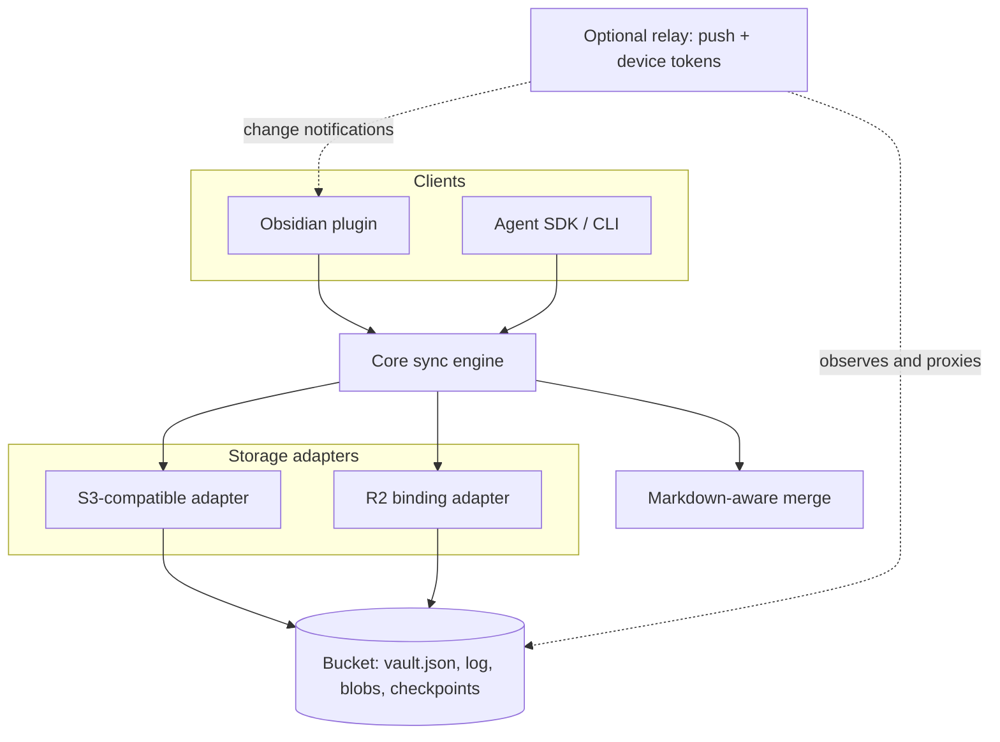

# Architecture

## Current

Status: accepted design, partly implemented. Existing behavior: `@obsy/protocol` (storage contract, records, commit rules), `@obsy/core` (sync engine and a minimal agent writer), `@obsy/storage-s3`, `@obsy/storage-testkit`, `@obsy/merge` (`merge3`), `@obsy/simulator`, and the platform probe in the plugin package; see the [development runbook](runbooks/development.md). Everything else on this page is accepted design.

obsy syncs an Obsidian vault between devices through storage you own, and lets programs and AI agents edit the same notes safely. This page owns the system boundaries, the layers, and the trust model. Each layer has its own subsystem page.

### Goals

- Sync a vault between desktop and mobile Obsidian with no data loss, including long offline edits.
- Work with any S3-compatible bucket that supports conditional writes. No server is required.
- Let scripts and AI agents edit notes through a small, safe API that never silently overwrites a human edit.
- Keep the stored format plain and inspectable: Markdown files stay Markdown files.
- Be easy for others to adopt: clear layers, small dependencies, permissive licence.

### Non-goals (version 1)

- Real-time co-editing of one note by several people. A per-note CRDT session can be added later on top of the same protocol.
- End-to-end encryption. A server-side agent that reads notes rules it out for that content. See [Security and trust](#security-and-trust).
- Background sync on iOS. The platform gives plugins no background time.
- Multi-user sharing and permissions.

### Layers

| Package | Responsibility | Runs in | Subject page |
| --- | --- | --- | --- |
| `@obsy/protocol` | Object layout, record schemas, format version, validation | Everywhere | [Protocol](subsystems/protocol.md) |
| `@obsy/merge` | Line-level three-way merge with a Markdown layer | Everywhere | [Merge and conflicts](subsystems/merge.md) |
| `@obsy/core` | Sync planner, commit loop, journal, change feed reader, agent operations | Everywhere (no Node or DOM dependencies) | [Protocol](subsystems/protocol.md) |
| `@obsy/storage-s3` | S3 API with SigV4 signing (`aws4fetch`), injectable `fetch` | Obsidian, Node, Workers | [Storage adapters](subsystems/storage.md) |
| `@obsy/storage-r2` | Native R2 binding | Cloudflare Workers | [Storage adapters](subsystems/storage.md) |
| `@obsy/storage-testkit` (test only) | In-memory `Storage`, conformance suite, race harness, fake S3 endpoint | Node (tests) | [Storage adapters](subsystems/storage.md#conformance-suite) |
| `@obsy/simulator` (test only) | Deterministic simulation of devices, an agent, and a faulty bucket; invariant checks | Node (tests) | [Simulator runbook](runbooks/simulator.md) |
| `@obsy/agent` | Safe edit operations and the `obsy` CLI | Node, Workers | [Agent SDK and CLI](subsystems/agent-sdk.md) |
| `obsy` Obsidian plugin (`packages/obsidian-plugin`) | Vault scanning, editor-safe apply, iOS lifecycle, settings, pairing | Obsidian desktop and mobile | [Obsidian plugin](subsystems/obsidian-plugin.md) |
| `@obsy/relay` (optional) | Cloudflare Worker + Durable Object: push notifications, device tokens, presence | Cloudflare | [Relay](subsystems/relay.md) |

Every layer above storage talks only to the `Storage` interface. Adding a provider means implementing that interface and passing the conformance suite. See [Storage adapters](subsystems/storage.md).

### Central idea: the bucket is the sequencer

Object storage that supports "create only if absent" can order commits by itself. Every writer tries to create the next numbered log entry. Exactly one succeeds; the others re-read, rebase, and retry. Delta Lake and Apache Iceberg commit to object storage the same way. This removes the need for a coordinating server. The [protocol page](subsystems/protocol.md) owns the layout and the commit algorithm. The [decision record](decisions/2026-10-19-bucket-as-sequencer.md) explains why this replaced the earlier server-centred proposal.

### Security and trust

- **Version 1 is server-trusted.** Content is readable by whoever controls the bucket. Use a private bucket, credentials scoped to that bucket, and provider-side encryption at rest.
- A server-side agent that reads notes cannot coexist with end-to-end encryption for those notes. obsy says so plainly rather than claiming otherwise.
- **Later:** optional encrypted folders. Content and paths in those folders are encrypted on devices; agents cannot read them and can only submit sealed proposals. Hashes there use a keyed HMAC so the bucket does not reveal content equality.
- The plugin sends no telemetry and contacts only the configured bucket or relay, as Obsidian's developer policies require.

The reasons are in [Server-trusted version 1](decisions/2026-10-19-server-trusted-v1.md).

### Related pages

- [Correctness and testing](concepts/correctness-and-testing.md): the invariants every layer must keep.
- [Roadmap](roadmap.md): build phases, open questions, and risks.
- [Sync design research](learning/sync-design-research.md): the evidence behind this design.

## History

- 2026-10-20: Phase 1 packages added: records and commit rules in `@obsy/protocol`, `@obsy/core`, and `@obsy/simulator`.
- 2026-10-20: Phase 0 packages added: the storage contract in `@obsy/protocol`, `@obsy/storage-s3`, `@obsy/storage-testkit`, and `merge3` in `@obsy/merge`.
- 2026-10-19: Design accepted. Commits are ordered by conditional creates in the bucket; the Durable Object proposal from the research became the optional relay. Content moved from the former `DESIGN.md` into this page and the subsystem pages.
